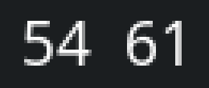

# TrayTemp

A small lightweight tray app for Windows 10/11 and KDE Plasma that shows the CPU and GPU temperature. Hovering an icon shows the current, minimum, maximum and average temperature since the app started.

## Footprint

Binary sizes are from release builds.

| Platform | Binary | Memory | CPU |
|---|---|---|---|
| Windows | 295 KB | ~2 MB | ~0 % |
| Linux (KDE Plasma 6) | 1.6 MB | ~9 MB | ~0 % |

Windows memory is the private working set (Task Manager, Details, "Memory" column); the total working set is larger because it includes pages shared with the system. Linux memory is RSS.

## Download and run

TrayTemp is a single executable (`traytemp.exe` on Windows, `traytemp` on Linux). There is no installer: download it and run it. Releases are attached to the tags of this repository.

## Screenshots

Windows, tray icons:


Windows, taskbar text:


KDE Plasma:

 

## Windows CPU temperature

Reading the CPU temperature needs kernel access to CPU registers, which Windows does not offer to normal programs. TrayTemp uses [PawnIO](https://github.com/namazso/PawnIO.Setup), a signed driver by namazso, and therefore needs administrator rights when "Show CPU temperature" is on.

If the driver is missing, TrayTemp asks before it downloads the PawnIO installer from `github.com/namazso/PawnIO.Setup`, and it checks the installer's signature before running it.

GPU temperature needs neither the driver nor administrator rights.

## What TrayTemp changes on your system

- **Settings file:** `%APPDATA%\TrayTemp\settings.ini` on Windows, `~/.config/traytemp/settings.ini` on Linux (or under `$XDG_CONFIG_HOME`).
- **"Start with Windows":**
  - With CPU temperature on: a Task Scheduler task named "TrayTemp" that runs with the highest privileges, and a copy of the exe at `C:\Program Files\TrayTemp\traytemp.exe`. The copy exists because an administrator task must never point at a file a normal user can modify.
  - With CPU temperature off: a value in `HKCU\Software\Microsoft\Windows\CurrentVersion\Run`.
- **Linux autostart:** `~/.config/autostart/traytemp.desktop`.
- **PawnIO**, if TrayTemp installed it.

## Uninstall

1. Untick "Start with Windows". This removes the task, the `Run` value and the Program Files copy. If TrayTemp is running from that copy, delete `C:\Program Files\TrayTemp` by hand afterwards.
2. Untick "Show CPU temperature". This offers to remove PawnIO, if TrayTemp installed it.
3. Exit TrayTemp.
4. Delete the exe and `%APPDATA%\TrayTemp`. On Linux, delete `~/.config/traytemp` and `~/.config/autostart/traytemp.desktop`.

## KDE notes

TrayTemp uses a StatusNotifierItem tray icon and follows the desktop font and colours. Only icon mode is available; the taskbar text mode is Windows-only.

## Building

```
cargo build --release
```

Windows needs the MSVC build tools and the Windows SDK. Linux release builds in CI use cargo-zigbuild, targeting glibc 2.28.

## Third-party notices

- **PawnIO modules** (`res/pawnio`: `IntelMSR.bin`, `AMDFamily17.bin`): from [PawnIO.Modules](https://github.com/namazso/PawnIO.Modules) 0.2.12, licensed LGPL-2.1. The licence text is `res/pawnio/COPYING`; checksums are in `res/pawnio/README.md`.
- **Rust crates** (direct dependencies):
  - `windows-sys` 0.61: MIT OR Apache-2.0
  - `ksni` 0.3: Unlicense
  - `libloading` 0.8: ISC

  Transitive dependencies and their licences are listed by `cargo tree` and `cargo metadata`.
